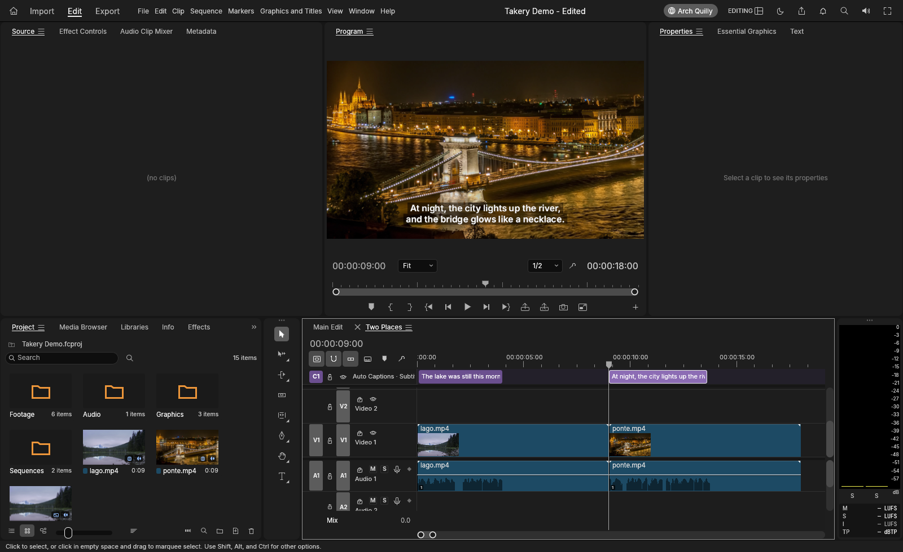
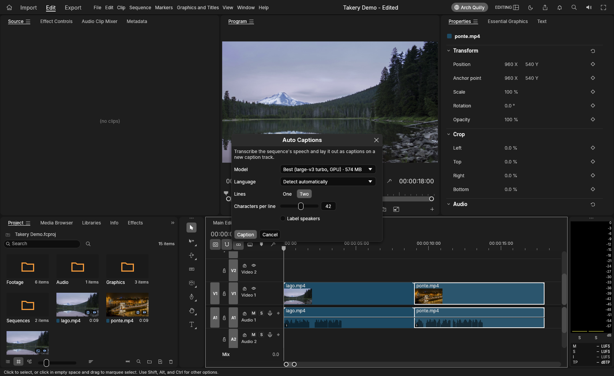
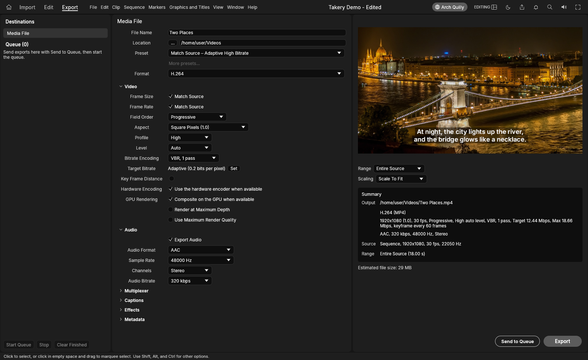

# Takery

**A native video editor for Linux, with one-click auto captions on the GPU.** Timeline editing, color, audio,
titles and hardware-accelerated export, in one fast Rust app. Takery is the video editor of the
[Arch Quilly](https://github.com/Sapyst/quilly) suite.



## What it does

- **Auto Captions** (Sequence › Captions › Auto Captions…, `Ctrl+Alt+Shift+C`): one click transcribes the
  sequence's speech and lays it out as captions on a new caption track. It runs in the background with a progress
  card and Cancel. The language is detected for you, or you choose it. Captions export to SRT, VTT, SCC, TTML and
  more, or burn into the video.
- **Whisper on the GPU** through whisper.cpp and Vulkan, with large-v3 turbo by default. The models are downloaded
  on request and checksum-checked. On an RTX 5070, 14 s of speech take about 1 s.
- **Editing:** a multi-track timeline with trimming, ripple, roll and slip edits, markers, nested sequences, multicam
  and transitions.
- **Color and audio:** Lumetri-style color with scopes and LUTs. An audio mixer with per-track effects and loudness
  meters.
- **Titles and graphics:** text and shapes on the timeline, editable in Essential Graphics.
- **Hardware acceleration by default:** VA-API and NVDEC decoding, NVENC H.264 encoding and the GPU export
  compositor. Each one falls back to the software path when the hardware isn't there.
- **Export:** H.264, HEVC, ProRes, DNxHR and more, with presets and a render queue.

| Auto Captions | Export with hardware encoding |
|---|---|
|  |  |

## Install

On Arch Linux, install the suite's package from the [Arch Quilly releases](https://github.com/Sapyst/quilly/releases).
That is `arch-takery` on its own, or the whole suite with `arch-quilly`. The Quilly hub keeps it up to date.
The GPU captions use `whisper-cpp` and `ggml-vulkan`, which the package pulls in.

```sh
sudo pacman -U arch-takery-*.pkg.tar.zst
```

To build it from source:

```sh
git clone https://github.com/storytold/craft-fonts ../craft-fonts
CRAFT_FONTS_DIR="$PWD/../craft-fonts" cargo build --release -p filmcraft --features whisper
```

The binary is `target/release/filmcraft`. The GPU captions need `whisper-cli` (whisper.cpp) built with Vulkan.

## Based on FilmCraft

Takery is a fork of **[FilmCraft](https://github.com/storytold/filmcraft) by the ArtCraft team**
(MIT OR Apache-2.0), which provides the engine and the editor. Takery adds:

- **Auto Captions** (`crates/engine/src/auto_captions.rs`, `crates/ui-egui/src/auto_captions.rs`);
- **Whisper on the GPU** (`crates/speech/src/whisper_cpp.rs`, the `gpu-whisper-*` models, pinned to
  ggerganov/whisper.cpp);
- hardware decoding, encoding and GPU export **on by default**;
- the **Aero** look (`crates/ui-egui/src/aero.rs`) and the suite's name, icon and links (`com.archquilly.Takery`,
  data in `~/.local/share/arch-quilly/takery`).

The ArtCraft name and marks are not used: as `docs/brand/LICENSE-brand.txt` asks of modified versions, the mark files
were removed from this branch and the app shows the suite's icon instead. FilmCraft's own README is kept in
[`docs/upstream-README.md`](docs/upstream-README.md). Branch `takery` follows FilmCraft's `main`
(`git fetch upstream && git rebase upstream/main`).

## License

Takery as a whole, and our changes, are under [GPL-3.0-or-later](LICENSE). The FilmCraft code it started from
is MIT OR Apache-2.0 by the ArtCraft team; those licenses, the `NOTICE` and `ATTRIBUTION.md` are kept
(`LICENSE-MIT`, `LICENSE-APACHE`). Releases before this change were MIT OR Apache-2.0 and stay so.

The clips in the screenshots are made from public-domain (CC0) photos from Wikimedia Commons,
[Lake Mountain Landscape](https://commons.wikimedia.org/wiki/File:Lake_Mountain_Landscape.jpg) and
[Széchenyi Chain Bridge in Budapest at night](https://commons.wikimedia.org/wiki/File:Sz%C3%A9chenyi_Chain_Bridge_in_Budapest_at_night.jpg).
The narration is a synthetic voice (espeak-ng).
